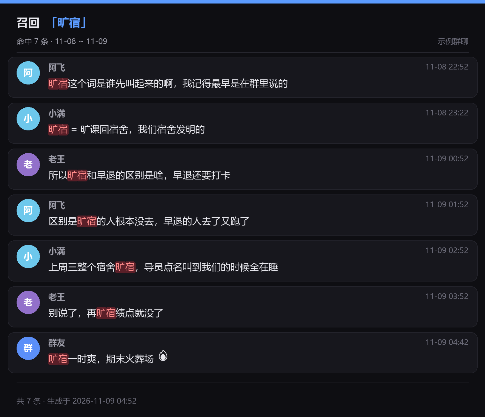

# 群聊考古

> 一句话：`召回 旷宿` —— 把这个群里所有提过「旷宿」的消息翻出来，做成一张带头像、昵称、精确时间的图片。

适合用来回溯群梗、找「谁说过那句话」、翻旧账、整理群内某个话题的黑历史。检索走本地 SQLite 索引，1.5 万条消息约 3ms 出结果，约 0.6 秒出图。



## 功能

- **关键词检索**：字面匹配，三级降级（整句 → 全词命中 → 任一词命中并按区分度排序）
- **引用触发**：引用一条消息后只发「召回」，自动把被引用正文当查询词
- **成图发送**：头像、昵称、时间、关键词红色高亮，超长正文自动截断，超过 15 条自动分页
- **被动建索引**：机器人收到消息即入库，图片同步缓存到本地（QQ 图片链接几天就失效）
- **历史回填**：首次见到某个群时，沿 OneBot 接口向前翻页补齐历史
- **权限与限流**：可全群开放或仅白名单，单人 8 秒 + 同群 10 秒冷却

## 安装

在 AstrBot 插件市场搜索「群聊考古」，或手动放进 `data/plugins/astrbot_plugin_group_archive/`。

依赖只有 AstrBot 自带的 `pillow`（AstrBot 核心依赖里已包含 `pillow>=11.2.1`），**不需要额外安装任何包**。

## 用法

```
召回 旷宿
召回 deepseek 涨价
```

引用某条消息后只发：

```
召回
```

查看索引覆盖范围（需唤醒前缀，或直接发「召回状态」）：

```
/考古状态
```

`召回` 不需要斜杠前缀。触发词可以在配置里改，比如改成 `考古`。

> 严格模式（默认开启）下，触发词后面必须跟空格或冒号，避免「召回率提高了」这种日常用语被误触发。想支持 `召回旷宿` 这种连写，把 `strict_trigger` 关掉。

## 兼容性

依赖 OneBot v11 扩展接口 `get_group_msg_history`，用到的参数是 `group_id` / `message_id` / `count` / `reverse_order`。

| 协议端 | 状态 |
|---|---|
| NapCat / LLOneBot | 支持该接口 |
| Lagrange.OneBot | 支持该接口 |
| SnowLuma | 支持该接口（本项目实测环境） |

单次最多返回 200 条，所以回填是循环翻页的。若某个实现忽略 `reverse_order`，插件会退化为顺序读取并在检测到重复锚点时停止，不会死循环。

**可回溯范围**：实测 QQ 服务器端群消息漫游约保留 3 个月，更早的拉不回来；但本地索引建立后一直有效，不会随着服务器删除而减少。

## 配置

| 键 | 默认 | 说明 |
|---|---|---|
| `enabled` | `true` | 总开关 |
| `allow_all` | `false` | 是否全群可用；关时看 `owner_ids`，名单空则仅群管理员 |
| `owner_ids` | `[]` | 白名单 QQ |
| `keywords` | `["召回"]` | 触发词 |
| `strict_trigger` | `true` | 触发词后必须带分隔符 |
| `group_cooldown_sec` | `10` | 同群两次检索最小间隔，0 不限制 |
| `default_days` | `60` | 默认回溯天数 |
| `max_items` | `30` | 最多返回条数 |
| `items_per_image` | `15` | 每张图几条 |
| `max_search_pages` | `12` | 查不到时实时补页上限（每页 200 条） |
| `backfill_enabled` | `true` | 首次见到群时回填历史 |
| `backfill_days` | `90` | 回填天数 |
| `cache_images` | `true` | 缓存消息图片 |
| `max_cache_mb` | `800` | 图片缓存上限 |
| `retention_days` | `0` | 索引保留天数，0 为永久 |

## 数据与隐私

插件会把**群聊消息文本**和**消息中的图片**存到本地：

```
data/plugin_data/astrbot_plugin_group_archive/
├── index.sqlite3    # 消息索引
├── images/          # 图片缓存
└── avatars/         # 头像缓存
```

这些数据**不会上传到任何第三方服务器**，只在本机。头像通过 `q1.qlogo.cn` 获取，属于 QQ 官方头像接口。

需要注意的几点：

- 开启 `allow_all` 等于让**群内任何人都能翻看本群的历史消息**，请自行判断群的性质再开
- 只想保留近期记录，把 `retention_days` 设成 90（索引会定期清理，图片缓存需手动删）
- 卸载插件不会自动删数据，需要手动删掉上面那个目录

## 实现说明

```
main.py                 触发、权限、冷却、分页发送
services/store.py       SQLite 索引与三级降级检索
services/indexer.py     被动记录、图片本地化、历史回填
services/renderer.py    Pillow 渲染（2 倍超采样，深色卡片）
services/onebot.py      OneBot 调用与消息段解析
utils/keywords.py       查询词切分（英文按词，中文按串 + 二元组）
utils/net.py            外部 URL 安全校验（拒绝内网地址）
```

几个踩过的坑，写在代码注释里了：

- aiocqhttp 适配器会丢弃纯空白 Plain 段，所以换行必须并进有内容的文本段
- 微软雅黑没有 emoji 字形，会渲染成方框，正文按字符分流到 `seguiemj.ttf`
- 消息图片地址来自群成员，直接请求会被拿来做 SSRF，所以只放行解析到公网 IP 的 http(s)
- 历史消息的图片链接多半已失效，每张卡片的远程图片有总耗时预算，不会卡在死链接上

## License

[MIT](LICENSE)
